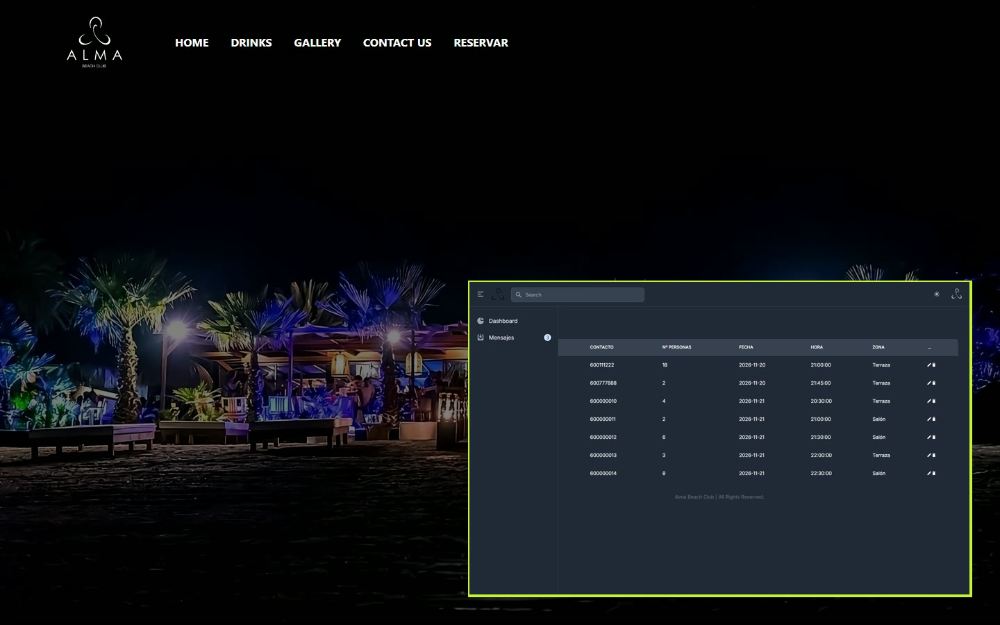

# Alma Beach Club · reservas

Web y sistema de reservas para un beach club de Mojácar (Almería). Fue mi proyecto final del ciclo de Desarrollo de Aplicaciones Web (DAW, 2024).



| Formulario de reserva | Panel de administración |
|---|---|
|  |  |

## Qué hace
- **Web pública:** inicio, carta de bebidas, galería y contacto con mapa.
- **Reservas online:** nombre, teléfono, número de personas, fecha, hora (de 16:00 a 01:00) y zona (Salón o Terraza).
- **Control de aforo:** antes de guardar una reserva se suman las personas ya reservadas en esa zona y en esa franja de una hora. El Salón admite 28 y la Terraza 20. Si no hay sitio, se avisa al cliente. Al modificar una reserva también se comprueba, sin contar la propia reserva.
- **Panel de administración:** con login, lista las reservas ordenadas por fecha y hora, de 10 en 10. Desde ahí se pueden modificar y borrar, con confirmación.

## Tecnologías
Laravel · PHP · MySQL / SQLite · Blade · Tailwind CSS · Flowbite · Laravel Breeze (login)

## Cómo arrancarlo
```bash
composer install
npm install && npm run build
cp .env.example .env
php artisan key:generate
php artisan migrate --seed
php artisan serve
```
- La web queda en `http://localhost:8000`.
- El panel está en `/login`. El usuario de prueba lo crea el seeder (`database/seeders/DatabaseSeeder.php`).

## Seguridad
- El registro público está desactivado: solo entra el personal del local.
- Modificar y borrar reservas exige haber iniciado sesión. El borrado se hace por `DELETE` con token CSRF.
- Los datos se validan también en el servidor, no solo en el formulario.
