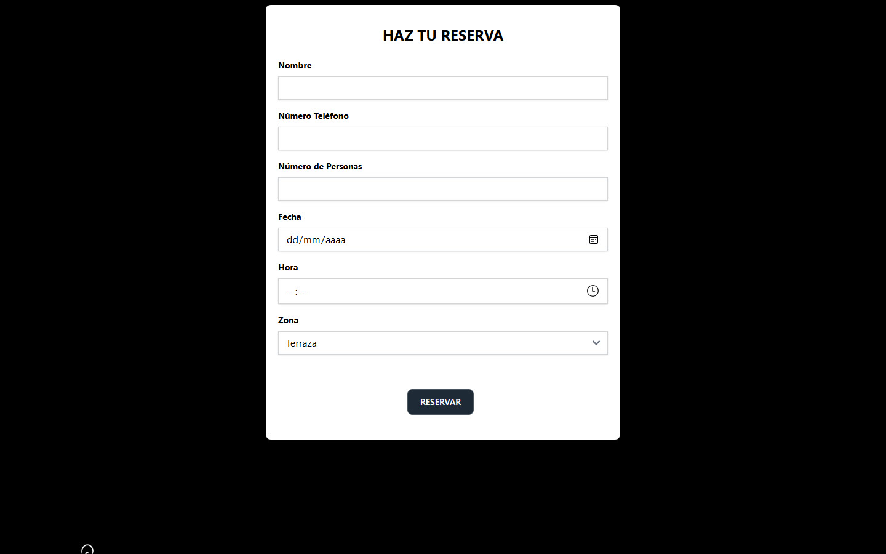
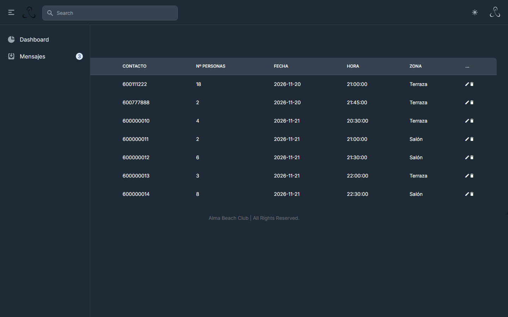

# Reservas para un beach club

Web de un beach club de Mojácar con reservas online y un panel para gestionarlas. La hice en 2024 con Laravel.


| Formulario de reserva | Panel de administración |
|---|---|
|  |  |

## Qué hace

La parte pública tiene inicio, carta de bebidas, galería y contacto con mapa. Desde ahí el cliente reserva indicando nombre, teléfono, número de personas, fecha, hora (de 16:00 a 01:00) y zona.

Antes de guardar la reserva se suman las personas que ya hay reservadas en esa zona y en esa hora. El salón admite 28 personas y la terraza 20, y si no queda sitio se avisa al cliente. Al modificar una reserva se hace la misma comprobación, sin contar la propia reserva.

El panel de administración pide login y lista las reservas por fecha y hora, de 10 en 10. Desde ahí se pueden modificar y borrar.

No hay registro público: solo entra el personal del local. Editar y borrar exige sesión iniciada, y los datos se validan también en el servidor.

Tecnologías: Laravel, PHP, MySQL, Blade, Tailwind CSS, Flowbite y Laravel Breeze para el login.

## Cómo arrancarlo

```bash
composer install
npm install && npm run build
cp .env.example .env
php artisan key:generate
php artisan migrate --seed
php artisan serve
```

La web queda en `http://localhost:8000` y el panel en `/login`. El usuario de prueba lo crea el seeder (`database/seeders/DatabaseSeeder.php`).
